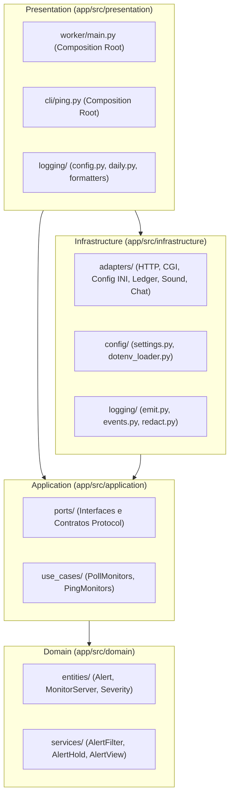

# Regra Arquitetural: DDD e Arquitetura Hexagonal

Esta regra define os limites, contratos e fluxos de dependência inegociáveis do projeto `nagstamon-headless`.

---

## 1. Topologia das Camadas

---

## 2. Invariantes de Dependência

1. **Isolamento Absoluto do Núcleo**:
   - `domain` e `application` **nunca** importam módulos de `infrastructure` nem de `presentation`.
   - `domain` contém apenas lógica de negócio pura (cálculos de SLA, regras de persistência de alertas, representação de entidades e formatação textual do snapshot).
   - O domínio não possui conhecimento de HTTP, bibliotecas externas (`httpx`), arquivos em disco ou variáveis de ambiente.

2. **Contratos Invertidos (Ports & Adapters)**:
   - Todo acesso ao mundo exterior (rede, sistema de arquivos, relógio, subprocessos de áudio, webhook) é mediado por contratos (`typing.Protocol`) definidos exclusivamente em `application/ports`.
   - Os adapters em `infrastructure/adapters` implementam esses protocolos.
   - Os casos de uso recebem os contratos injetados no construtor via `__init__`, permitindo substituição total por fakes em testes unitários sem mocks invasivos.

3. **Composition Root Concentrado**:
   - O ponto onde todos os adapters concretos são instanciados e conectados aos casos de uso reside única e exclusivamente na camada de apresentação:
     - `presentation.worker.main`: inicialização do daemon de polling contínuo.
     - `presentation.cli.ping`: inicialização da rotina one-shot de diagnóstico de servidores.

4. **Diretrizes de Qualidade do Código**:
   - **Zero comentários**: O código de aplicação deve ser autoexplicativo através de nomenclatura expressiva de classes, métodos e variáveis.
   - **Tipagem Estrita**: Todos os métodos e funções devem possuir anotações de tipo completas em conformidade com o `mypy --strict`.
   - **Limite de Complexidade**: Nenhum arquivo em `app/src` deve ultrapassar 300 linhas de código. Ao se aproximar deste limite, extraia responsabilidades coesas.
