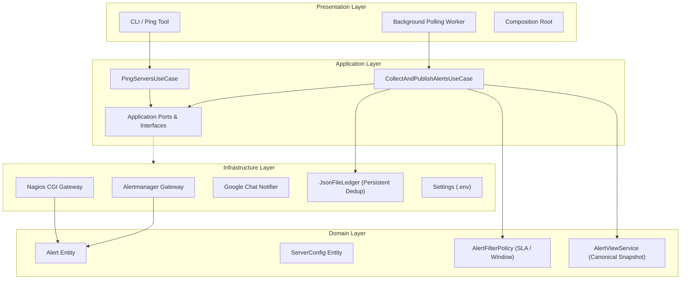

# Nagstamon Headless

[](https://github.com/victorhc-silveira-ilegra/nagstamon-headless/actions/workflows/ci.yml)
[](https://github.com/victorhc-silveira-ilegra/nagstamon-headless/releases)
[](https://www.python.org/downloads/)
[](app/pyproject.toml)
[](https://docs.astral.sh/ruff/)
[](https://mypy-lang.org/)
[](https://pre-commit.com/)
[](https://www.conventionalcommits.org/)
[](https://semantic-release.gitbook.io/)
[](docs/arquitetura.md)

Daemon autônomo headless projetado para consultar múltiplos servidores de monitoramento (Prometheus Alertmanager e Nagios CGI), aplicar filtros determinísticos de ruído (reconhecimento/ack, carência de hold-down por criticidade SLA, filtragem por janela temporal e dias úteis) e consolidar os **alertas efetivos** em snapshot unificado de texto puro para o terminal (`stdout`) e publicação no Google Chat.

## Visão Geral da Arquitetura

O sistema é construído sobre os pilares de **Domain-Driven Design (DDD)** e **Arquitetura Hexagonal (Ports & Adapters)**, garantindo desacoplamento total entre as regras de negócio de monitoramento e os protocolos de infraestrutura externa:



## Características Principais

- **Paridade Canônica de Snapshots**: O texto emitido em `stdout` e a mensagem transmitida via webhook do Google Chat (`{"text": "..."}`) compartilham 100% da mesma estrutura e campos formatados por `domain/services/alert_view.py`.
- **Deduplicação Persistente e Confiável**: Deduplicação em ledger de arquivo (`DEDUP_LEDGER_PATH`) por hash SHA-256 (`server` + `alertname` + `app` + `host`), impedindo renotificação de incidentes persistentes em ciclos subsequentes.
- **Carência SLA e Supressão de Flapping**:
  - Muito Crítico: 10 minutos (`FILTER_HOLD_FAST_SECONDS=600`).
  - Mediano / Crítico: 15 minutos (`FILTER_HOLD_CRITICAL_SECONDS=900`).
  - Baixo / Warning: 20 minutos (`FILTER_HOLD_WARNING_SECONDS=1200`).
  - Informativo (Info): Descarte imediato sem emissão.
- **Janela Operacional Flexível**: Controle de turno comercial via `WINDOW_*` com suporte a captura de incidentes pré-existentes ativos ao boot (`WINDOW_ALLOW_PAST_ACTIVE_ALERTS=true`).
- **Desofuscação de Credenciais**: Carregamento transparente das configurações de servidores Nagstamon (`~/.nagstamon/servers/*.conf`), decodificando senhas locais com o mesmo algoritmo original do Nagstamon.

## Instalação e Configuração

### Pré-requisitos

- Python 3.11 ou superior
- Docker (opcional, para execução isolada em contêiner)

### Inicialização do Ambiente

```bash
# Clone e configuração inicial de ambiente
cp .env.example .env
make app-setup
```

Ajuste as variáveis no arquivo `.env` local de acordo com seu ambiente de rede:

| Variável | Descrição | Padrão |
| :--- | :--- | :--- |
| `SERVERS_DIR` | Diretório contendo os arquivos `.conf` dos servidores | `~/.nagstamon/servers` |
| `REFRESH_INTERVAL_SECONDS` | Intervalo em segundos entre os ciclos de polling | `60` |
| `HTTP_PROXY` / `HTTPS_PROXY` | Proxy corporativo opcional | Vazio |
| `GCHAT_WEBHOOK_URL` | Webhook HTTP do Google Chat para notificações | Vazio (desabilitado) |
| `DEDUP_LEDGER_PATH` | Caminho do arquivo JSON do ledger de deduplicação | `.dedup_ledger.json` |
| `LOG_DIR` | Diretório de gravação dos logs diários do sistema | `logs` |

## Comandos Operacionais

Todas as tarefas de desenvolvimento e ciclo de vida são expostas via `Makefile`:

```bash
# Quality Gates
make app-lint         # Análise estática de código (Ruff, Flake8)
make app-security     # Varredura de segurança (Bandit, Safety)
make app-test         # Execução de testes com branch coverage 100%
make app-validate     # Validação de integridade de schemas e configurações
make app-build        # Validação de build

# Operações Locais
make app-ping         # Executa teste de conectividade contra todos os servidores
make app-run          # Inicia o daemon localmente no terminal
make app-clean        # Remove caches, arquivos temporários e logs antigos

# Execução Conteinerizada (Docker)
make docker-up        # Inicializa o serviço em contêiner em segundo plano
make docker-smoke     # Executa validação de saúde do contêiner ativo
make docker-logs      # Acompanha logs consolidados e snapshots em tempo real
make docker-down      # Interrompe e remove o contêiner
```

## Integração Contínua e Harness de Agentes

- **Matriz CI/CD**: Matriz de 4 categorias (`Python`, `Docker`, `GitHub`, `Scripts`) e 5 estágios estritos (`Lint`, `Security`, `Test`, `Validate`, `Build`) documentada em [docs/devops.md](docs/devops.md).
- **Harness Universal de Agentes**: Regras e habilidades interoperáveis para agentes inteligentes em [.agents/](.agents/).
- **Documentação Técnica Completa**: Disponível no diretório [docs/](docs/).
