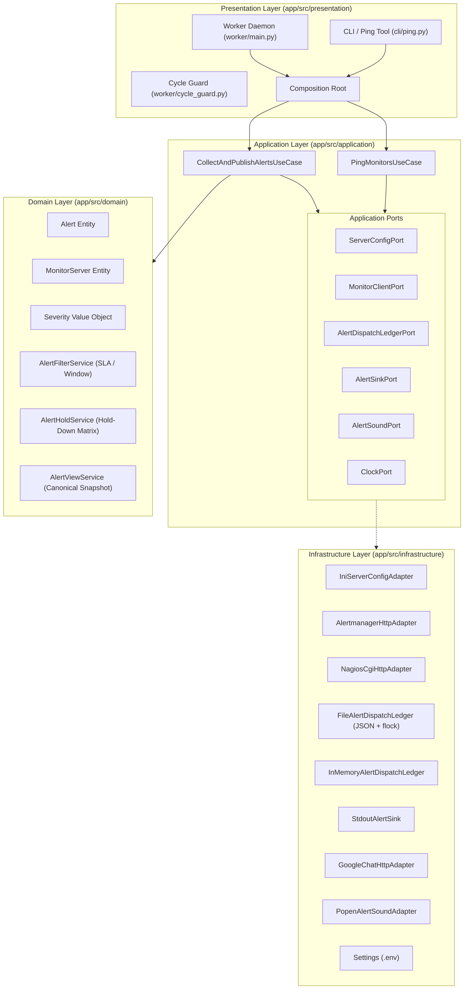

# Arquitetura do Nagstamon Headless

Este documento especifica a arquitetura técnica, as fronteiras de domínio e os padrões de projeto adotados no **Nagstamon Headless**.

## 1. Visão Geral e Paradigma Arquitetural

O sistema é estruturado em conformidade com os princípios de **Domain-Driven Design (DDD)** e **Arquitetura Hexagonal (Ports & Adapters)**. As regras de negócio, cálculos temporais e políticas de enriquecimento de incidentes permanecem estritamente isoladas de protocolos de rede, detalhes de persistência e saídas de terminal.

## 2. Divisão e Responsabilidade das Camadas

### 2.1 Camada de Domínio (`app/src/domain`)

O núcleo do sistema. Contém a lógica de negócio pura, sem dependências de frameworks, bibliotecas HTTP ou utilitários externos.

- `entities/monitor_server.py`: Representação do servidor monitorado (URL, autenticação, tipo de monitor, estado ativo/inativo).
- `entities/alert.py`: Entidade representativa do alarme coletado. Possui o método `dedup_key()`, gerando a assinatura canônica de unicidade SHA-256 baseada em `server` + `alertname` + `app` + `host`.
- `entities/severity.py`: Enumeração normalizada de severidades operacionais.
- `services/alert_filter.py`: Orquestrador de descarte de ruído, avaliando confirmação prévia (ack), janelas temporais de turno, dias úteis configurados e integridade de timestamps.
- `services/alert_hold.py`: Matriz de carência temporal (hold-down) por criticidade e severidade.
- `services/alert_view.py`: Serviço de projeção canônica do snapshot em texto puro, calculando duração, tempo de SLA decorrido e identificadores estáveis.

*Invariante*: O domínio nunca emite chamadas de log e desconhece qualquer detalhe de IO.

### 2.2 Camada de Aplicação (`app/src/application`)

Orquestra os fluxos de trabalho do sistema, coordenando entidades e portas abstratas.

- `ports/server_config.py`: Contrato para carregamento e persistência do estado dos servidores (`list_enabled`, `list_all`, `set_enabled`).
- `ports/monitor_client.py`: Contrato para consulta paralela aos servidores (`fetch_all`).
- `ports/alert_dispatch_ledger.py`: Contrato transacional de deduplicação (`try_claim`, `confirm`, `release`).
- `ports/alert_sink.py`: Contrato de publicação de snapshots (`publish`).
- `ports/alert_sound.py`: Contrato de feedback sonoro (`play_new_alert`).
- `ports/clock.py`: Contrato de abstração temporal para testes determinísticos.
- `use_cases/poll_monitors.py`: Caso de uso principal: executa ciclo de coleta, normalização, filtragem, deduplicação em ledger, publicação multicanal e disparo de áudio.
- `use_cases/ping_monitors.py`: Caso de uso de diagnóstico: executa probe HTTP paralelo e atualiza flags de ativação nos arquivos de configuração.

### 2.3 Camada de Infraestrutura (`app/src/infrastructure`)

Implementa as portas da aplicação utilizando bibliotecas e protocolos específicos.

- `adapters/ini_server_config.py`: Leitor e gravador de arquivos `.conf` no formato INI do Nagstamon, com algoritmo de desofuscação de credenciais.
- `adapters/alertmanager_http.py`: Cliente HTTP para API v2 do Prometheus Alertmanager.
- `adapters/nagios_cgi_http.py`: Parser resiliente de tabelas HTML expostas por interfaces CGI do Nagios.
- `adapters/file_alert_dispatch_ledger.py`: Ledger persistente em disco (JSON) com travamento concorrente via `fcntl.flock`.
- `adapters/in_memory_alert_dispatch_ledger.py`: Ledger em memória com `threading.Lock` para ambientes efêmeros.
- `adapters/stdout_alert_sink.py`: Projeção do snapshot formatado no fluxo padrão do terminal.
- `adapters/google_chat_http.py`: Disparo da mensagem em formato texto para o webhook configurado do Google Chat.
- `adapters/popen_alert_sound.py`: Reprodução de alerta sonoro via subsistema de áudio local (`paplay` / `aplay`).
- `config/settings.py`: Mapeamento tipado de variáveis de ambiente.

### 2.4 Camada de Apresentação (`app/src/presentation`)

Pontos de entrada da aplicação e composição do ciclo de vida.

- `worker/main.py`: Ponto de entrada do serviço daemon e composition root principal.
- `worker/cycle_guard.py`: Mecanismo anti-overlap que impede a execução de ciclos concorrentes no mesmo processo.
- `cli/ping.py`: Utilitário de linha de comando para probe pontual de servidores.
- `logging/`: Configuração de formatadores, filtros de redução de ruído e gravação contínua em arquivo diário.

## 3. Políticas de Negócio Detalhadas

### 3.1 Carência Temporal por Criticidade (Hold-Down)

Para evitar reações a alarmes oscilantes ou transitórios (flapping), a matriz de carência impõe o tempo mínimo de persistência ativa do alarme antes do envio:

| Criticidade | Escopo de Aplicação | Variável de Ambiente | Duração Padrão |
| :--- | :--- | :--- | :--- |
| **Muito Crítico** | Hosts inacessíveis (DOWN), esgotamento de disco, certificados TLS expirados, falhas de pagamento ou autenticação | `FILTER_HOLD_FAST_SECONDS` | 10 minutos (600s) |
| **Mediano** | Demais ocorrências com severidade `CRITICAL` | `FILTER_HOLD_CRITICAL_SECONDS` | 15 minutos (900s) |
| **Baixo** | Ocorrências com severidade `WARNING`, métricas de CPU, memória, load, latência e oscilações | `FILTER_HOLD_WARNING_SECONDS` | 20 minutos (1200s) |
| **Informativo** | Ocorrências com severidade `INFO` ou sem início determinável | N/A | Descarte imediato |

*Nota*: Palavras-chave semânticas no nome do alerta ou serviço sobrepõem a severidade declarada.

### 3.2 Janela Operacional e Preservação de Incidentes Ativos

A janela operacional restringe o envio às jornadas de trabalho:
- `WINDOW_ENABLED`: Habilita ou ignora a validação de horários.
- `WINDOW_START` e `WINDOW_END`: Limites da jornada (ex.: `13:30` às `18:00`).
- `WINDOW_DAYS`: Dias da semana autorizados (ex.: `mon,tue,wed,thu,fri`).
- `WINDOW_ALLOW_PAST_ACTIVE_ALERTS`: Quando ativo (padrão `true` para turnos matutinos), incidentes cujo início tenha ocorrido antes da abertura da janela (ex.: durante a madrugada ou prévios à inicialização do daemon) são despachados normalmente no primeiro ciclo de coleta, impedindo que falhas graves fiquem invisíveis.

### 3.3 Protocolo de Ledger de Deduplicação

Para assegurar idempotência sem reenvio ruidoso a cada minuto:
1. **Identificador Imutável**: Hash SHA-256 de `server` + `alertname` + `app` + `host`. Atributos dinâmicos (consumo percentual, tempo decorrido, descrição volátil) não compõem a chave.
2. **Ciclo de Estados**:
   - `claim`: Verifica se a chave já consta como despachada (`sent`). Se não constar, assume propriedade temporária do envio.
   - `confirm`: Registra a chave como confirmada no disco após sucesso na publicação. O registro permanece ativo indefinidamente enquanto o problema persistir nos monitores.
   - `release`: Em caso de falha de transmissão (ex.: timeout no Google Chat), a chave é liberada para nova tentativa no próximo ciclo.
   - `reconcile`: Quando o incidente deixa de ser reportado pelo monitor e decorre o tempo de retenção (`DEDUP_WINDOW_MINUTES`), a entrada é purgada do ledger.
