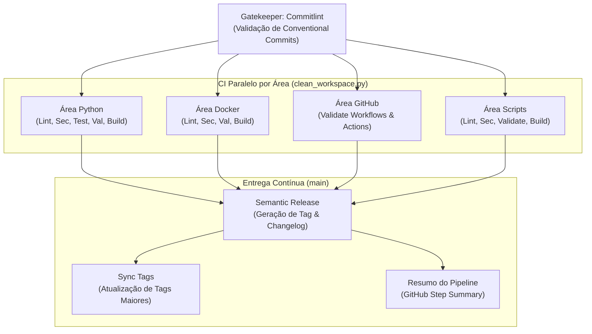

# DevOps, CI/CD e Automação Contínua

Especificação formal da esteira de Integração Contínua (CI), Entrega Contínua (CD) e governança de qualidade do **Nagstamon Headless**.

## 1. Topologia da Esteira de CI/CD

O pipeline executado em pushes e pull requests na branch `main` adota execução paralela por área temática, convergindo para o job de versionamento semântico (`release`):



## 2. Matriz de Qualidade Unificada (4 Áreas x 5 Estágios)

A validação de software segue a estratégia *fail-fast* (crash-first) em 5 estágios determinísticos:

| Área Temática | Estágio 1: Lint | Estágio 2: Segurança | Estágio 3: Testes | Estágio 4: Validação | Estágio 5: Build |
| :--- | :--- | :--- | :--- | :--- | :--- |
| **Python** | Ruff, Flake8, Mypy strict, Vulture (código morto), checagem de 300 linhas | Bandit (SAST), Pip-audit (vulnerabilidades), Gitleaks | Pytest com branch coverage 100% | `pip install -e` + validação de import | `python -m build` (geração de wheel) |
| **Docker** | Hadolint (`infra/docker/.hadolint.yaml`) | Trivy (análise de vulnerabilidades na imagem) | Validação estrutural do Compose | Inspeção de arquivos e variáveis | Build da imagem de CI (`nagstamon-headless:ci`) |
| **GitHub** | Actionlint | Gitleaks no diretório `.github` | Actionlint (análise semântica) | Validação de integridade de composite actions | Validação da árvore de actions |
| **Scripts** | ShellCheck e `bash -n` | Varredura de credenciais e permissões | Execução de alvos help do Makefile | Integridade de scripts do Makefile | Verificação de sintaxe de automações |

## 3. Bidirecionalidade e Comandos de Validação Local

O CI/CD local e o CI/CD do GitHub Actions compartilham estrita paridade bidirecional: o que é validado no pre-commit/local é validado no GitHub Actions, e vice-versa.

```bash
# Execução da esteira completa idêntica ao CI com tabela de resumo
make app-ci          # ou make ci

# Execução por estágio em todas as 4 áreas temáticas
make app-lint        # Lint geral (Python, Docker, GitHub, Scripts)
make app-security    # Varredura de segurança completa
make app-test        # Execução da suíte de testes com cobertura 100%
make app-validate    # Validação estrutural e integridade
make app-build       # Verificação de build de pacotes e contêineres

# Executa todos os hooks do pre-commit em todos os arquivos
make app-pre-commit-run
```

## 4. Governança de Commits e Release Semântica

- **Conventional Commits**: Padrão obrigatório verificado por hook local do Commitlint (`linters/commitlint.config.mjs`). Commits que não respeitem a especificação são rejeitados antes do push.
- **Semantic Release**:
  - `feat:` gera incremento `minor` de versão.
  - `fix:` gera incremento `patch` de versão.
  - `feat!:`, `fix!:` ou rodapé `BREAKING CHANGE:` geram incremento `major`.
  - Atualização automática do histórico em [docs/CHANGELOG.md](CHANGELOG.md) e publicação de GitHub Release com as notas correspondentes.
- **Supressão de CD**: Mensagens de commit contendo `[skip-cd]` ou disparos manuais via `workflow_dispatch` com `skip_cd: true` executam exclusivamente os testes de CI, omitindo a geração de release.
